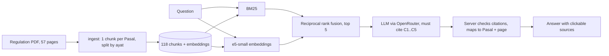

# RAG Akademik ITS

Ask questions about the academic rules of Institut Teknologi Sepuluh Nopember (ITS) in Indonesian and get an
answer that cites the exact article (Pasal), clause (ayat), and page of the official regulation,
[Peraturan Rektor ITS Nomor 33 Tahun 2025](https://www.its.ac.id/pendidikan/2026/01/23/peraturan-akademik-tahun-2025/).

**Live demo:** https://rag-akademik-its.onrender.com (free instance: the first visit after a quiet period takes about a minute to wake up)

Every answer is checked on the server: the model may only cite passages it was given, citations to anything else
are dropped, and when the regulation does not cover a question the assistant says so instead of guessing.

## Results

Measured on a frozen set of 70 questions ([how it was made](eval/README.md)): 60 answerable ones labelled with
the Pasal that answers them, and 10 the regulation does not cover.

**Retrieval** (60 answerable questions, CPU; full table in [eval/retrieval_results.md](eval/retrieval_results.md)):

| Setup | hit@1 | hit@5 | MRR | p95 latency |
| --- | --- | --- | --- | --- |
| BM25 (keywords) | 0.70 | 0.95 | 0.800 | < 1 ms |
| Dense (multilingual-e5-small) | 0.68 | 0.90 | 0.771 | 19 ms |
| Hybrid, BM25 + dense with rank fusion | 0.80 | 0.93 | 0.849 | 19 ms |
| **Same, e5-small as quantised ONNX (shipped)** | **0.80** | **0.93** | **0.847** | **5 ms** |
| Hybrid + cross-encoder reranker | 0.85 | 0.95 | 0.890 | 2.1 s |

The reranker adds 0.04 MRR but makes retrieval about 100 times slower on a free CPU, so it is off by default.
The shipped app runs the quantised ONNX export of e5-small with a SentencePiece tokenizer and no PyTorch: the
container uses about 285 MB of RAM and fits a free 512 MB instance, at the same retrieval quality.

**Answers** ([eval/answer_results.md](eval/answer_results.md)):

| Metric | Result |
| --- | --- |
| Answerable questions answered instead of refused | 95% (57/60) |
| Answers citing at least one correct Pasal | 91% (52/57) |
| Answers an LLM judge rated faithful to their sources | 88% (50/57) |
| Questions outside the regulation correctly refused | 100% (10/10) |
| Median time per answer (free LLM) | 10 s |

A hand check of 15 answers found 13 faithful; the judge agreed on 10 of 15 and was stricter than the hand check
in every disagreement. Failure examples and the judge prompt are in [eval/](eval/).

## How it works



- **Ingestion** ([rag/ingest.py](rag/ingest.py)): the PDF is an OCR'd scan, so article headings come out as
  `Pasa137` or `Fasal 55`. Headings are matched loosely and accepted only when they continue the sequence, which
  keeps cross-references such as "...sebagaimana diatur dalam Pasal 40." from starting a new article. Tests check
  that all 91 articles come out exactly once.
- **Retrieval** ([rag/retrieve.py](rag/retrieve.py)): keywords and embeddings fail on different questions (BM25
  misses paraphrases, embeddings miss exact terms such as "SKEM"), so their rankings are fused. With 118 chunks a
  numpy matrix is enough; a vector database would add a service and nothing measurable.
- **Answers** ([rag/answer.py](rag/answer.py)): the model sees five labelled passages and must cite them. The
  server renumbers citations, drops ones that point outside the retrieved set, and shows no sources for a refusal.
  OpenRouter is called with a fallback list of free models, so a busy model does not take the demo down.
- **Runtime** ([rag/encoders.py](rag/encoders.py)): the Hugging Face `tokenizer.json` alone took 245 MB of RAM for
  the 250k-token vocabulary, so the app tokenises with the 5 MB SentencePiece model instead. A test checks that both
  give identical token ids on every chunk and question.
- **Web app** ([app/](app/)): FastAPI streams the answer as server-sent events to a plain HTML, CSS, and JavaScript
  page. Model text is inserted as text, never as HTML.

## Run it

```bash
cp .env.example .env            # add your OpenRouter key
docker compose up               # http://localhost:7860
docker compose run --rm app pytest
docker compose run --rm app python eval/run_retrieval.py   # retrieval comparison
docker compose run --rm app python eval/run_answers.py     # answer evaluation (calls the LLM)
```

After changing ingestion or the encoder: `python -m scripts.build_index --encoder intfloat/multilingual-e5-small --mode hybrid`.

CI runs the unit tests and fails if retrieval MRR on the question set drops more than 0.02 below the recorded
baseline.

## Limitations

- The source is an OCR'd scan with typos ("cuff" for "cuti", "dosen wall" for "dosen wali"). They are kept as is,
  so the quoted text shows them; the hybrid search tolerates most of them.
- One document only. Faculty rules, fees, and scholarships live in other regulations and are out of scope.
- The question set was drafted with an AI assistant from the regulation text and reviewed by the author; the
  answer judge is also an LLM, spot-checked by hand ([eval/answer_results.md](eval/answer_results.md)).
- Answers come from free LLMs and can still be wrong. The page tells users to check the cited article.

## Source document

`data/peraturan-rektor-33-2025.pdf`, published by ITS (Direktorat Pendidikan Sarjana dan Pascasarjana, posted
23 January 2026). SHA-256 `569231920939945b54e9e15629a4349cabc469e4385c1b840a92945fe6e35dc5`.

Code: MIT. The regulation belongs to ITS and is included unchanged.
